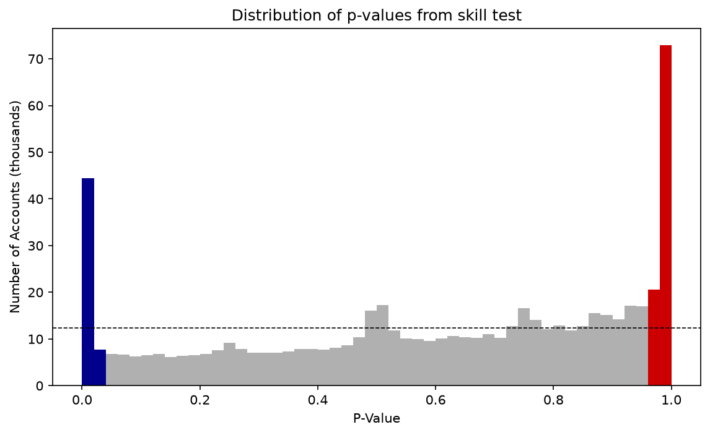
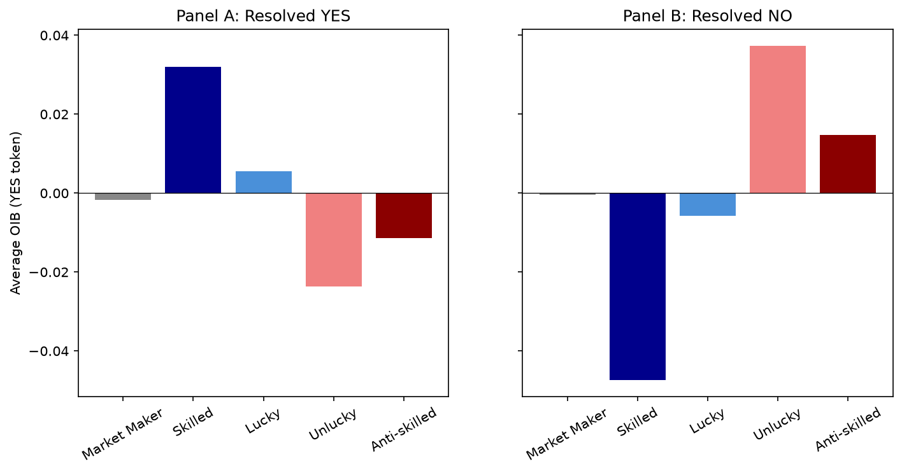

# Who makes prediction markets accurate? A reproduction on the full Polymarket record

This project reproduces *Prediction Market Accuracy: Crowd Wisdom or Informed Minority?* (Gómez-Cram, Guo, Jensen and Kung, 2026) from public data. The paper finds that Polymarket's accuracy comes from a small, persistently skilled minority of about 3% of accounts, not from the wisdom of the crowd and not from insiders.

Starting from raw on-chain fills, the pipeline rebuilds every account's trading history across about 208,000 markets and 1.7 million accounts ($12.6B of volume, 2023 to 2025), classifies accounts with the paper's sign-randomization skill test, and re-estimates the price-discovery regressions. I did this as the last project of my 2026 quantitative research internship at Bloomberg.

## Main results

The headline classification reproduces closely.

| Quantity | Reproduced | Paper |
|---|---|---|
| Markets with at least one trade | 208,079 | 210,322 |
| Events with at least one trade | 98,974 | 98,906 |
| Accounts classified | 1,708,410 | 1,720,000 |
| Skilled accounts | 55,120 (3.23%) | 54,325 (3.16%) |
| Anti-skilled accounts | 101,135 (5.92%) | 105,951 (6.15%) |
| Total one-sided volume | $12.6B | $13.8B |
| Train/test correlation of skill p-values | 0.34 | 0.35 |

The skill test compares each account's realized profit with the profits it would have made had its direction in each event been a coin flip. The p-values show the paper's shape: spikes of significantly skilled accounts (blue) and significantly anti-skilled accounts (red) on top of a roughly uniform middle.



Skilled traders' order flow points toward the eventual outcome. In the last 5% of a market's life they are net buyers of YES in markets that resolve YES and net sellers in markets that resolve NO, while the unlucky and anti-skilled trade the other way.



The price-discovery regressions reproduce in sign and significance, with smaller coefficients.

| Regression | Reproduced coefficient | Paper |
|---|---|---|
| Next-period price change on skilled order imbalance | 1.13 (t = 11.7) | 2.05 (t = 12.8) |
| Final outcome on skilled order imbalance | 4.04 (t = 11.8) | 7.77 (t = 9.6) |
| Change in pricing error on skilled volume share | −5.90 (t = −6.4) | −4.95 |
| Same, final 20% of market lifespan | −11.7 (t = −10.7) | −9.53 |

Over the full lifespan of a market, skilled trading reduces the pricing error more than any other group's, and the effect grows sharply toward resolution.

## Where the reproduction differs

- Skill persists out of sample, but less strongly than in the paper. Of the accounts classified as skilled on a random half of the events, 34% are skilled on the other half (paper: 46%), and 66% remain profitable (paper: about 70%). Because the correlation of p-values between the halves matches the paper, the gap most likely comes from how accounts near the skilled/lucky boundary are classified in each half rather than from the data.
- The price-discovery coefficients are about half the paper's. One plausible reason is that prices here are last-trade prices derived from fills, while the paper uses the order book's quote series.
- The insider analysis (Tables 6 and 7) is implemented but was not run for the results above. It needs an LLM to label about 219,000 market questions as insider-prone, which the pipeline supports (see below).

The full comparison is in [`outputs/REPORT.md`](outputs/REPORT.md), and the methodology notes, including every deviation, are in [`docs/METHODOLOGY.md`](docs/METHODOLOGY.md).

## A data-cleaning step worth knowing about

Polymarket's exchange contract emits an `OrderFilled` event for both sides of every trade and routes one leg through operator wallets. Summing raw fills therefore double-counts volume and mislabels which side supplied liquidity, which breaks the paper's market-maker rule. Dropping every fill that involves one of ten operator addresses matches Polymarket's own reported volume (ratio 1.00 across binary and multi-outcome markets) and restores the maker/taker labels. As a check, total profit and loss across all accounts sums to zero.

## Data

- Market and event metadata from Polymarket's GAMMA API.
- On-chain `OrderFilled` events from the Goldsky orderbook subgraph, decoded into per-account trades with a maker/taker flag.

The subgraph stops indexing around 28 April 2026. The paper's sample ends on 31 December 2025, and the collector can extend it to April 2026. Raw data is not included; the collectors rebuild it (hundreds of millions of fills, so plan for a long, resumable download).

## Setup and usage

Requires Python 3.12+ and [uv](https://docs.astral.sh/uv/).

```sh
uv sync
python run_collect.py                  # collect markets and trades (resumable, per-month checkpoints)
python run_analysis.py --skip-insider  # rebuild every table, figure and outputs/REPORT.md
```

For the insider module, the market questions are labeled with Claude Haiku at temperature 0, following the paper's prompt and model (Appendix C.2). Provide an Anthropic API key, then run:

```sh
export ANTHROPIC_API_KEY=...
python -m src.insider.llm_classify
python run_analysis.py
```

Details and cost estimates are in [`docs/insider_classification.md`](docs/insider_classification.md).

## Layout

```
config.py              paths, sample window, thresholds, endpoints
run_collect.py         collect the full market and trade universe
run_extend.py          collect additional months into 2026
run_analysis.py        run the analysis pipeline and regenerate outputs
src/
  collect/             GAMMA metadata and subgraph fills
  build/               operator cleaning, account-event PnL, time bins
  skill/               sign-randomization test, classification, persistence
  pricediscovery/      order-imbalance and accuracy regressions (Tables 4 and 5)
  strategies/          public-information strategies and news reaction (Table 8)
  insider/             LLM labels, insider proxies, case study
  report/              tables, figures, comparison report
docs/                  methodology and insider-classification notes
outputs/               regenerated tables, figures and REPORT.md
```

## Reference

M. Gómez-Cram, H. Guo, T. I. Jensen and H. Kung (2026). Prediction Market Accuracy: Crowd Wisdom or Informed Minority? SSRN working paper. The paper is not included here; it is available from SSRN.
