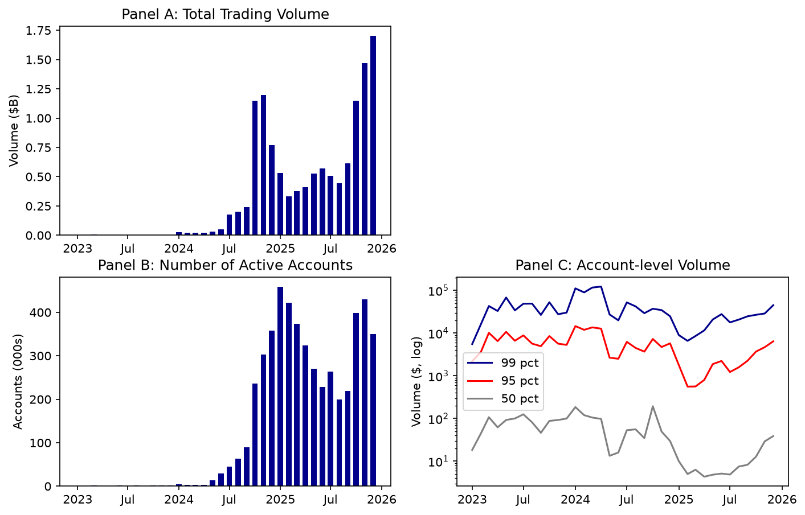
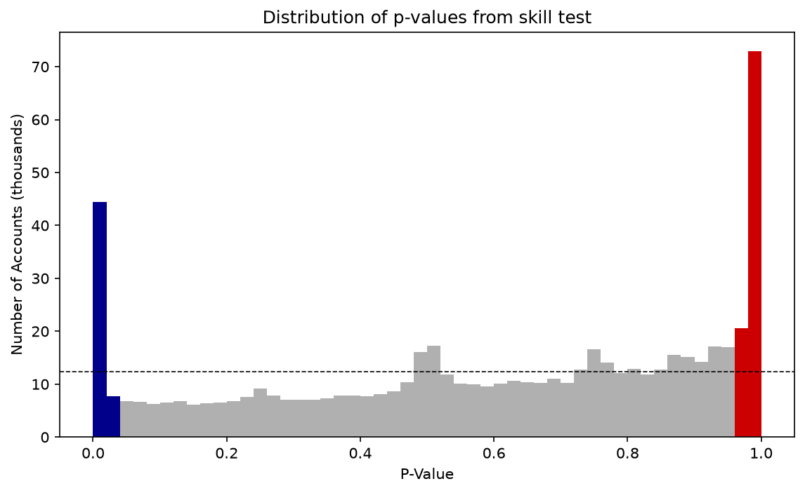
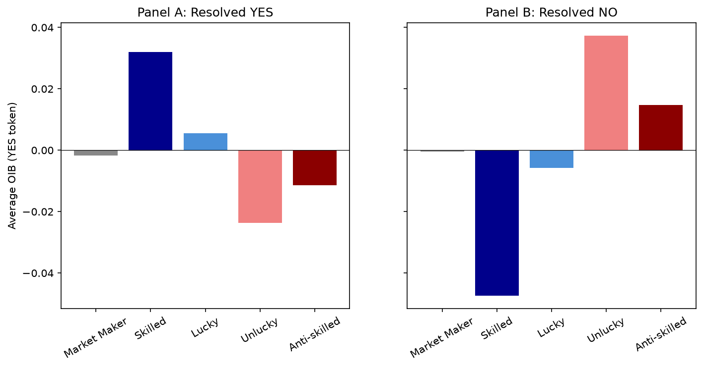
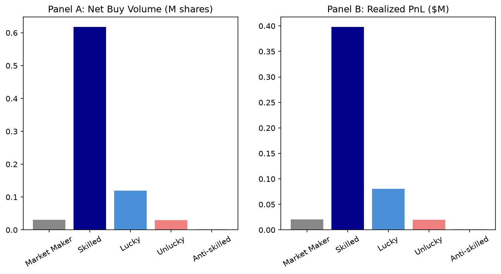
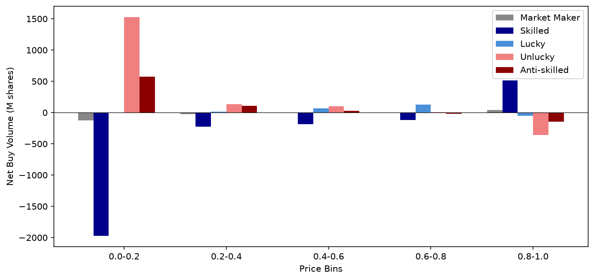
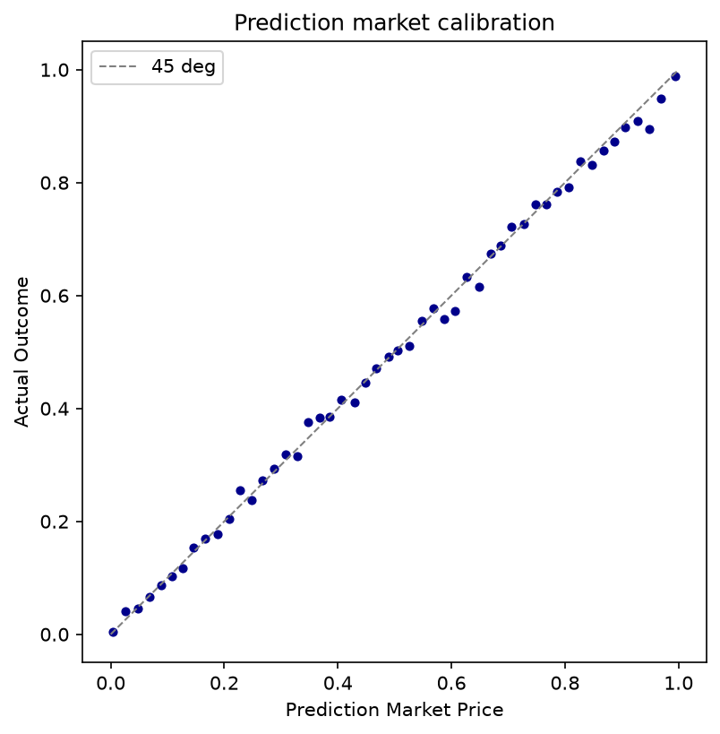

# Reproduction Report

Prediction Market Accuracy: Crowd Wisdom or Informed Minority? (Gomez-Cram, Guo, Jensen, Kung 2026).

Reproduced from the public Polymarket data (GAMMA metadata + Goldsky orderbook subgraph fills). Target: magnitudes + conclusions.

## Headline comparison

| Quantity | Reproduced | Paper | Dev | Note |
|---|---|---|---|---|
| Markets (>=1 trade) | 208,079 | 210,322 | -1% |  |
| Events (>=1 trade) | 98,974 | 98,906 | +0% |  |
| Accounts classified | 1,708,410 | 1,720,000 | -1% |  |
| Skilled count | 55,120 | 54,325 | +1% |  |
| Skilled % of all | 3.23 | 3.16 | +2% |  |
| Anti-skilled count | 101,135 | 105,951 | -5% |  |
| Anti-skilled % of all | 5.92 | 6.15 | -4% |  |
| Total volume ($B) | 12.57 | 13.76 | -9% |  |
| p-value corr (train/test) | 0.34 | 0.35 | -3% |  |
| Skilled->Skilled persistence | 0.34 | 0.46 | -26% |  |

## Price discovery (Table 4, skilled OIB)

| Dep var | Reproduced beta (t) | Paper |
|---|---|---|
| Delta p_t+1 | 1.13 (11.7) | 2.05 (12.8) |
| outcome | 4.04 (11.8) | 7.77 (9.6) |

## Regenerated artifacts

Tables: `outputs/tables/*.csv` (+ `.tex`). Figures: `outputs/figures/*.png`.

See `docs/METHODOLOGY.md` for methodology notes and deviations.

